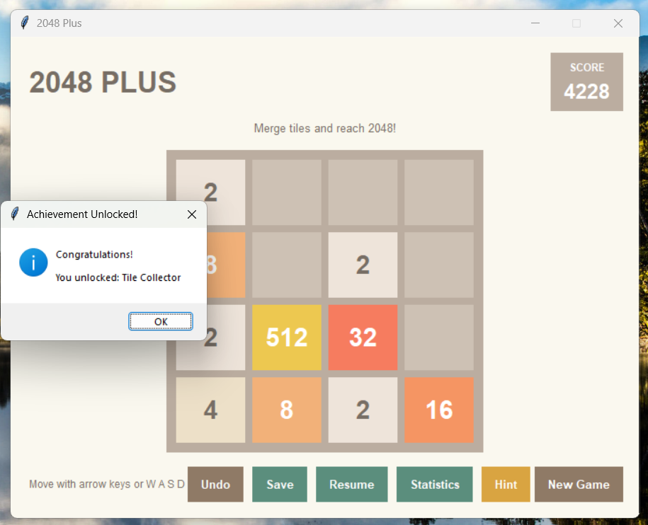

# 2048 Plus — A Smart Puzzle Game


2048 Plus is a Python-based desktop puzzle game inspired by the classic 2048 game. It builds on the original concept with useful features like move hints, undo, save and resume, player statistics, and achievements.

## Overview

**2048 Plus** is an intermediate-level Python project created to put practical programming skills into action through an interactive desktop application.

The project brings together game logic, a graphical user interface, data storage, automated testing, and a modular code structure. It also provides hands-on experience with building, testing, and maintaining a Python application.

## Features

- **Interactive Gameplay:** Play the 2048 puzzle using keyboard controls.
- **Hint System:** Get a suggested move without affecting the board or score.
- **Undo:** Go back to a previous game state whenever needed.
- **Save and Resume:** Save your current game and pick up where you left off.
- **Player Statistics:** Keep track of gameplay information across sessions.
- **Achievements:** Unlock achievements as you make progress in the game.
- **Graphical Interface:** Play through a desktop interface built with Tkinter.
- **Automated Tests:** Test the core game logic, hint system, statistics, and save/load functionality.

## Technologies Used

- Python
- Tkinter
- JSON for storing game data and statistics
- `unittest` for automated testing
- Anaconda and Spyder for development
- GitHub Actions for automated testing

## Project Structure

```text
2048-Plus/
├── .github/
│   └── workflows/
│       └── python-tests.yml
├── main.py
├── game/
│   ├── __init__.py
│   ├── engine.py
│   ├── statistics.py
│   └── hint_engine.py
├── ui/
│   ├── __init__.py
│   └── main_window.py
├── storage/
│   ├── save_manager.py
│   ├── savegame.json
│   └── statistics.json
└── tests/
    ├── test_engine.py
    ├── test_hint_engine.py
    ├── test_statistics.py
    └── test_save_manager.py
```

The application generates the JSON files when game saves or statistics are stored. These files may not appear in the project folder until the corresponding features have been used.

## Getting Started

### Requirements

- Python 3
- Tkinter support
- Anaconda with Spyder, or another compatible Python development environment

On Ubuntu or Debian-based Linux systems, Tkinter can be installed with:

```bash
sudo apt install python3-tk
```

### Running the Application

**Using Spyder:**

1. Open the project folder in Spyder.
2. Set the project folder as the current working directory.
3. Open `main.py`.
4. Press **F5** to run the application.
5. Use the keyboard controls and on-screen buttons to play.

**Using the Command Line:**

Open a terminal in the project root directory and run:

```bash
python main.py
```

On some systems, use:

```bash
python3 main.py
```

## Running the Tests

The project includes automated tests for the game engine, hint engine, statistics, and save manager.

**Using Spyder:**

1. Open the required test file from the `tests` folder.
2. Make sure the project root is set as the current working directory.
3. Press **F5** to run it.
4. Check the output to confirm that the tests pass.

Run each test module separately to check the main components of the application.

**Using the Command Line:**

From the project root directory, run all test modules together:

```bash
python -m unittest discover -s tests -v
```

## GitHub Actions Workflow

This project uses GitHub Actions to automate unit testing.

The workflow is configured to run when code is pushed to the `main` branch or when a pull request targets `main`.

It automatically:

- Checks out the repository.
- Sets up Python 3.12.
- Runs the complete unit test suite.
- Reports whether the tests passed or failed.

The workflow file is located at `.github/workflows/python-tests.yml`.

## About the Hint System

The Hint System evaluates the four possible move directions and suggests the move with the best estimated result.

It uses factors such as empty cells, the largest tile, neighboring tile values, and score. It is a simple one-move heuristic rather than an advanced AI search algorithm.

The hint calculation does not change the actual game board, score, or undo history.

## Skills Demonstrated

- Python programming and object-oriented design
- Game-state management and matrix operations
- Graphical user interface development
- File handling and JSON serialization
- Input validation and error handling
- Unit testing and debugging
- Modular project organization
- Feature integration and regression testing
- Basic CI/CD using GitHub Actions

## Future Improvements

There is room to expand the game with additional features, including:

- Difficulty settings and customizable board sizes
- Improved visual themes and animations
- Additional gameplay modes
- More detailed statistics and performance summaries
- Additional edge-case tests and test coverage reporting

## Project Status

The core game features have been implemented. The application has also passed manual GUI regression checks and component-level automated tests. The GitHub Actions workflow has been configured and successfully executed.

## Screenshots

### Gameplay


### Hint Feature


### Statistics


### Achievements



### Game Over


## Author

Developed as a Python desktop application project for learning, hands-on practice, and portfolio development.
