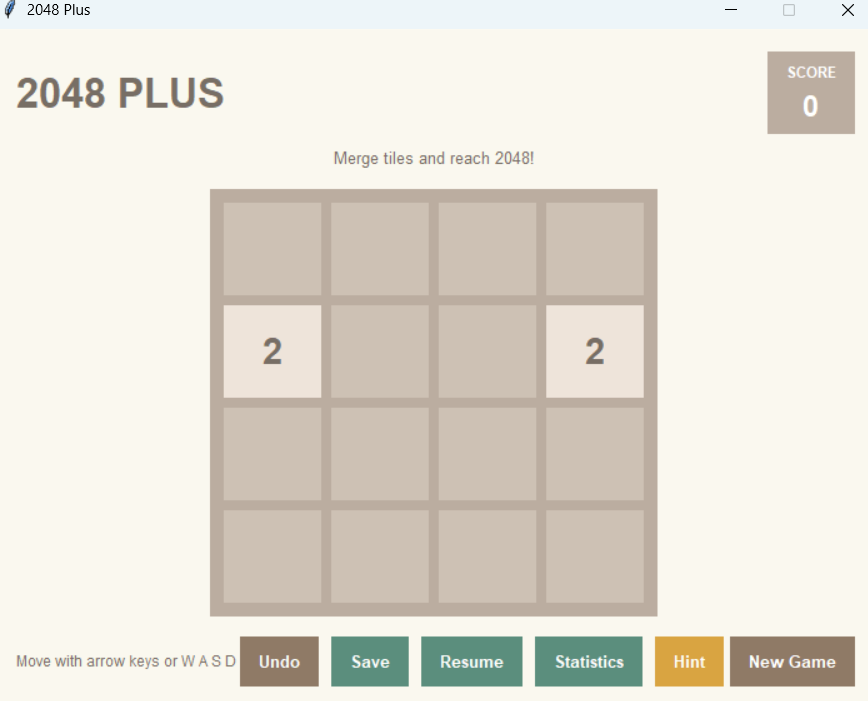
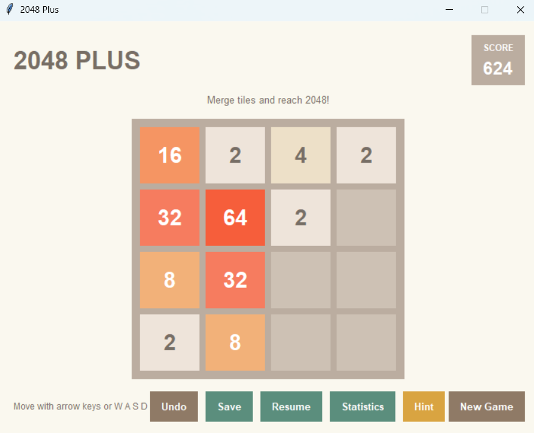
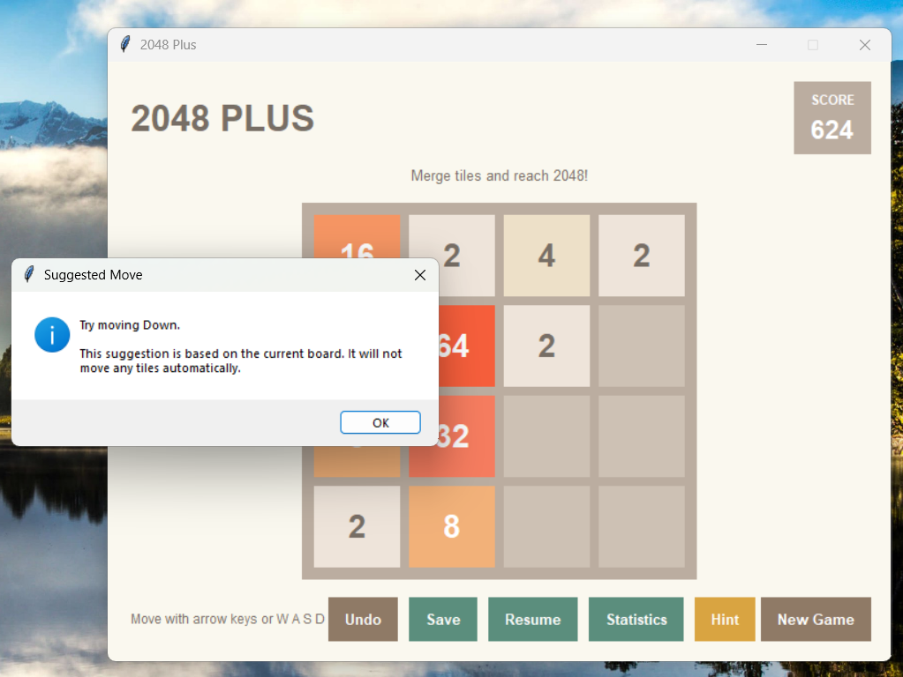
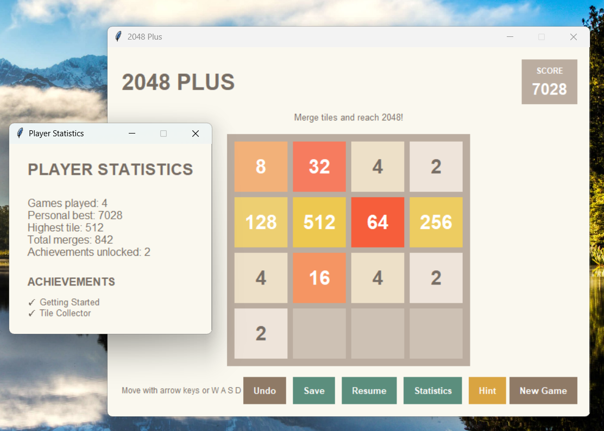
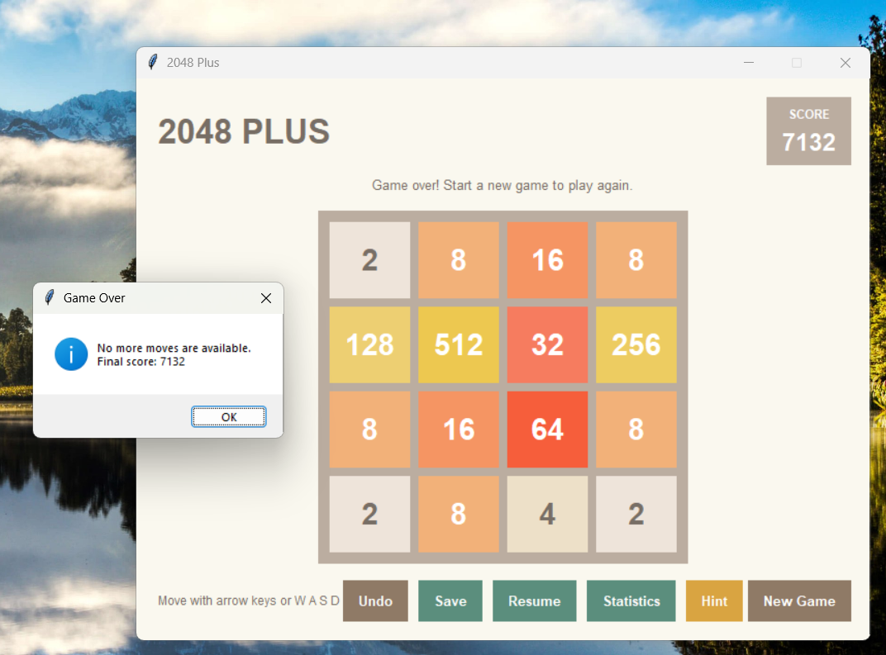

# 2048 Plus — A Smart Puzzle Game

A Python-based desktop puzzle game inspired by the classic 2048 game, enhanced with helpful features such as move hints, undo, save/resume, player statistics, and achievements.

## Overview

**2048 Plus** is an intermediate-level Python project built to demonstrate practical software development skills through an interactive desktop application.

The project combines game logic, a graphical user interface, persistent data storage, automated unit testing, and modular code organization.

## Features

- **Interactive gameplay:** Play the 2048 puzzle using keyboard controls.
- **Hint system:** Receive a suggested move without changing the board or score.
- **Undo:** Restore a previous game state.
- **Save and resume:** Save the current game and continue later.
- **Player statistics:** Track gameplay information across sessions.
- **Achievements:** Unlock achievements based on game progress.
- **Graphical interface:** Use a desktop GUI built with Tkinter.
- **Automated tests:** Validate core game logic, hints, statistics, and save/load behavior.

## Technologies Used

- Python
- Tkinter
- JSON for persistent storage
- `unittest` for automated testing
- Anaconda and Spyder for development

## Project Structure

```text
2048-Plus/
├── main.py
├── game/
│   ├── __init__.py
│   ├── engine.py
│   ├── statistics.py
│   └── hint_engine.py
├── ui/
│   ├── __init__.py
│   └── main_window.py
├── storage/
│   ├── save_manager.py
│   ├── savegame.json
│   └── statistics.json
└── tests/
    ├── test_engine.py
    ├── test_hint_engine.py
    ├── test_statistics.py
    └── test_save_manager.py
```

The JSON files are generated by the application when game saves or statistics are stored. They may not exist until the relevant features are used.

## Getting Started

### Requirements

- Python 3
- Tkinter support
- Anaconda with Spyder, or another compatible Python development environment

### Run the Application

1. Open the project folder in Spyder.
2. Open `main.py`.
3. Run the file using **F5**.
4. Use the keyboard controls and on-screen buttons to play.

## Running the Tests

The project includes automated tests for the game engine, hint engine, statistics, and save manager.

To run a test module in Spyder:

1. Open the relevant test file from the `tests` folder.
2. Run it using **F5**.
3. Review the test output and confirm that the tests pass.

Run each test module separately to verify the main components.

## Skills Demonstrated

- Python programming and object-oriented design
- Game-state management and matrix operations
- Graphical user interface development
- File handling and JSON serialization
- Input validation and error handling
- Unit testing and debugging
- Modular project organization
- Feature integration and regression testing

## Future Improvements

- Difficulty settings and customizable board sizes
- Improved visual themes and animations
- Additional gameplay modes
- Enhanced statistics and performance summaries
- More edge-case tests and test coverage reporting

## Project Status

The core game features are implemented, and the game has passed manual GUI regression checks and component-level automated tests.

## Screenshots

### Gameplay



### Hint Feature


### Statistics


### Achievements


### Game Over


## Author

Developed as a Python desktop application project for learning, practice, and portfolio development.
